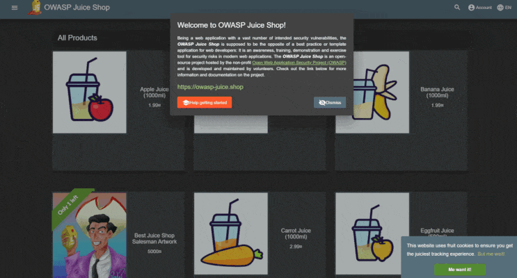

| Что | Где |
| --- | --- |
| **Последний pipeline** | https://devsecops.gitlab.yandexcloud.net/s24130742/sprint-3-cicd/-/pipelines/11032 |
| **Бейдж** | [](https://devsecops.gitlab.yandexcloud.net/s5448462/main-task/-/pipelines)  |
| **DAST_TARGET** | https://ginandjuice.shop |
| **SAST отчёт** | [security-reports/sast-report.json](https://devsecops.gitlab.yandexcloud.net/s24130742/sprint-3-cicd/-/blob/main/security-reports/sast-report.json) |
| **SCA отчёт** | [security-reports/sca-report.json](https://devsecops.gitlab.yandexcloud.net/s24130742/sprint-3-cicd/-/blob/main/security-reports/sca-report.json) |
| **SBOM** | [security-reports/sbom.spdx](https://devsecops.gitlab.yandexcloud.net/s24130742/sprint-3-cicd/-/blob/main/security-reports/sbom.spdx) |
| **DAST отчёт** | [security-reports/dast-report.html](https://devsecops.gitlab.yandexcloud.net/s24130742/sprint-3-cicd/-/blob/main/security-reports/dast-report.html) |
| **Логи гейтов** | [artifacts/ci/gate-sast.log](https://devsecops.gitlab.yandexcloud.net/s24130742/sprint-3-cicd/-/blob/main/artifacts/ci/gate-sast.log), [artifacts/ci/gate-sca.log](https://devsecops.gitlab.yandexcloud.net/s24130742/sprint-3-cicd/-/blob/main/artifacts/ci/gate-sca.log), [artifacts/ci/gate-dast.log](https://devsecops.gitlab.yandexcloud.net/s24130742/sprint-3-cicd/-/blob/main/artifacts/ci/gate-dast.log) |
| **Лог ZAP** | [artifacts/ci/zap-baseline-log.txt](https://devsecops.gitlab.yandexcloud.net/s24130742/sprint3_cicd/-/jobs/44216/artifacts/download) |

> **Обоснование использования DAST_TARGET:** До локальной вм GitLab Runner с тегом yandex не доходит

## Карта доказательств

| Критерий | Доказательство |
| --- | --- |
| **SAST: ≥3 уязвимости и триаж** | [Таблица триажа SAST](#таблица-триажа-sast) |
| **SCA: CVE ≥7.0 обработаны** | [Сводка CVE](#сводка-cve) |
| **DAST: отчёт и лог** | [`security-reports/dast-report.html`](https://devsecops.gitlab.yandexcloud.net/s24130742/sprint-3-cicd/-/blob/main/security-reports/dast-report.html), [`artifacts/ci/zap-baseline-log.txt`](https://devsecops.gitlab.yandexcloud.net/s24130742/sprint3_cicd/-/jobs/44216/artifacts/download) |
| **Гейты: срабатывание** | [artifacts/ci/gate-sast.log](https://devsecops.gitlab.yandexcloud.net/s24130742/sprint-3-cicd/-/blob/main/artifacts/ci/gate-sast.log), [artifacts/ci/gate-sca.log](https://devsecops.gitlab.yandexcloud.net/s24130742/sprint-3-cicd/-/blob/main/artifacts/ci/gate-sca.log), [artifacts/ci/gate-dast.log](https://devsecops.gitlab.yandexcloud.net/s24130742/sprint-3-cicd/-/blob/main/artifacts/ci/gate-dast.log) |

## Описание проекта и окружения

- **CI/CD**: GitLab CI с общим раннером `yandex` (docker executor)
- **Приложение**: OWASP Juice Shop (Node.js + Express)
- **Архитектура пайплайна**: 3 стейджа — SAST (semgrep), SCA (trivy), DAST (ZAP)

## Описание .gitlab-ci.yml

Пайплайн состоит из трёх независимых стейджей, выполняющих разные аспекты безопасности. Все джобы используют общий раннер с тегом `yandex` (docker executor).

stages:
  - sast   # статический анализ semgrep
  - sca    # анализ зависимостей trivy
  - dast   # динамическое тестирование zap

### Структура пайплайна

```
sast (semgrep) → sca (trivy) → dast (zap)
```

| Стейдж  | Инструмент | Назначение |
| --- |  --- | --- |
| `sast` | Semgrep | Поиск уязвимостей в исходном коде |
| `sca` |  Trivy | Сканирование зависимостей и генерация SBOM |
| `dast` | OWASP ZAP | Динамическое тестирование безопасности |

### Артефакты

Каждый джоб сохраняет артефакты строго по заданным путям:

| Джоб | Артефакты |
| --- | --- |
| `semgrep` | `security-reports/sast-report.json`, `artifacts/ci/gate-sast.log` |
| `trivy` | `security-reports/sca-report.json`, `security-reports/sbom.spdx`, `artifacts/ci/gate-sca.log` |
| `zap` | `security-reports/dast-report.html`, `security-reports/dast-report.json`, `artifacts/ci/zap-baseline-log.txt`, `artifacts/ci/gate-dast.log` |

### Логика гейтов

В каждом джобе реализован security-гейт:
- **SAST**: `severity: "ERROR"` → `exit 1`
- **SCA**: `CVSS ≥ 7.0` → `exit 1`
- **DAST**: `risk: "High" или "Critical"` → `exit 1`

## Интеграция инструментов безопасности

### SAST

**Конфигурация:**
p/javascript - Базовые правила безопасности для JavaScript
p/nodejs - Специфичные правила для Node.js
p/security-audit - Расширенный аудит безопасности

**Найденные уязвимости:** 

#### Таблица триажа SAST

| Rule/ID | CWE | Severity | File:Line | Решение | Обоснование |
| --- | --- | --- | --- | --- | --- |
| `javascript.sequelize.security.audit.sequelize-injection-express.express-sequelize-injection` | CWE-89 | **ERROR** | [routes/login.ts:34](https://devsecops.gitlab.yandexcloud.net/s24130742/sprint-3-cicd/-/blob/main/routes/login.ts?ref_type=heads#L34) | Исправить | SQL Injection в логине — пользовательский ввод передаётся в запрос |
| `javascript.sequelize.security.audit.sequelize-injection-express.express-sequelize-injection` | CWE-89 | **ERROR** | [routes/search.ts:23](https://devsecops.gitlab.yandexcloud.net/s24130742/sprint-3-cicd/-/blob/main/routes/search.ts#L23) | Исправить | UNION-based SQL Injection в поиске — чтение/изменение БД |
| `javascript.lang.security.audit.code-string-concat.code-string-concat` | CWE-95 | **ERROR** | [routes/userProfile.ts:62](https://devsecops.gitlab.yandexcloud.net/s24130742/sprint-3-cicd/-/blob/main/routes/userProfile.ts#L62) | Исправить | Использование `eval()` с user-input → удалённое выполнение кода (RCE) |

**Гейт:** `severity: "ERROR"` → `exit 1`  
**Лог гейта:** [`artifacts/ci/gate-sast.log`](https://devsecops.gitlab.yandexcloud.net/s24130742/sprint-3-cicd/-/blob/main/artifacts/ci/gate-sast.log)

### SCA 

**Отчёт Trivy:** [`security-reports/sca-report.json`](https://devsecops.gitlab.yandexcloud.net/s24130742/sprint-3-cicd/-/blob/main/security-reports/sca-report.json)  
**SBOM (SPDX):** [`security-reports/sbom.spdx`](https://devsecops.gitlab.yandexcloud.net/[ВАШ_ЮЗЕРНЕЙМ]/sprint3_cicd/-/jobs/[JOB_ID_SCA]/artifacts/download)

#### Сводка CVE

| Метрика | Значение |
| --- | --- |
| Critical (CVSS ≥ 9.0) | 29 |
| High (7.0–8.9) | 22 |

#### CVE к немедленной обработке (≥7.0)

| CVE | Пакет | Версия | CVSS | Действие | Комментарий |
| --- | --- | --- | --- | --- | --- |
| CVE-2023-46233 | crypto-js | 3.3.0 | 9.1 | Обновить до ≥4.2.0 | PBKDF2 в 1,3 млн раз слабее стандарта |
| CVE-2015-9235 | jsonwebtoken | 0.4.0 | 9.8 | Обновить до ≥4.2.2 | Обход верификации JWT |
| CVE-2019-10744 | lodash | 2.4.2 | 9.1 | Обновить до ≥4.17.12 | Prototype pollution |
| GHSA-5mrr-rgp6-x4gr | marsdb | 0.6.11 | Critical | Заменить пакет | Командная инъекция через `$where` (не исправлен) |
| CVE-2023-32314 | vm2 | 3.9.17 | 9.8 | Обновить до ≥3.9.18 | Побег из песочницы → RCE |
| CVE-2020-15084 | express-jwt | 0.1.3 | 9.1 | Обновить до ≥6.0.0 | Обход авторизации |
| CVE-2022-25881 | http-cache-semantics | 3.8.1 | 7.5 | Обновить до ≥4.1.1 | ReDoS атака |
| CVE-2024-4068 | braces | 2.3.2 | 7.5 | Обновить до ≥3.0.3 | Memory Exhaustion |
| CVE-2022-25887 | sanitize-html | 1.4.2 | 7.5 | Обновить до ≥2.7.1 | ReDoS |
| CVE-2025-47935 | multer | 1.4.5-lts.2 | 7.5 | Обновить до ≥2.0.0 | DoS через memory leak |
| CVE-2024-37890 | ws | 7.4.6 | 7.5 | Обновить до ≥7.5.10 | DoS через большое количество заголовков |

### Примечание

Перед сканированием был добавлен файл `package-lock.json` в репозиторий, что позволило Trivy выполнить анализ зависимостей.

**Гейт:** `CVSS ≥ 7.0` → `exit 1`  
**Лог гейта:** [`artifacts/ci/gate-sca.log`](https://devsecops.gitlab.yandexcloud.net/s24130742/sprint-3-cicd/-/blob/main/artifacts/ci/gate-sca.log)

### DAST

**Методика тестирования:** Baseline scan без авторизации

**Целевой URL:** `https://ginandjuice.shop` (переменная `DAST_TARGET`)

> **Обоснование использования DAST_TARGET:** До локальной вм GitLab Runner с тегом yandex не доходит

В джобе zap добавлен || true, чтобы сканирование продолжалось даже при наличии WARN-уязвимостей (это не влияет на гейт) 

**Результаты:**
- High: 0
- Medium: 2
- Low: 7
- Informational: 4

**Вывод о применимости ZAP baseline для продакшн-пайплайна:**

ZAP baseline подходит для **pre-commit** и **pre-deploy to staging**, но **не для production-пайплайна**. Причины:
1. Пассивное сканирование не выявляет все классы уязвимостей (SQLi, RCE требуют активных атак)
2. Нет поддержки авторизованных сессий (JWT, cookies)
3. Не проверяет бизнес-логику и IDOR

**Рекомендации по улучшению:**
1. Настроить аутентификацию в ZAP (context + user)
2. Использовать активное сканирование (active scan) на staging
3. Добавить API-сканирование с OpenAPI спецификацией
4. Запускать полные сканы ночью, baseline — на каждый PR

**Лог сканирования:** [`artifacts/ci/zap-baseline-log.txt`](https://devsecops.gitlab.yandexcloud.net/s24130742/sprint-3-cicd/-/blob/main/security-reports/dast-report.html)
**Гейт:** `risk: "High" или "Critical"` → `exit 1`  
**Лог гейта:** [`artifacts/ci/gate-dast.log`](https://devsecops.gitlab.yandexcloud.net/s24130742/sprint-3-cicd/-/blob/main/artifacts/ci/gate-dast.log)

## Security-гейты

| Гейт | Условие | Реализация | Статус |
| --- | --- | --- | --- |
| **SAST** | `severity: "ERROR"` → `exit 1` | В джобе `semgrep` | Отключён |
| **SCA** | `CVSS ≥ 7.0` → `exit 1` | В джобе `trivy` | Отключён |
| **DAST** | `risk: "High" или "Critical"` → `exit 1` | В джобе `zap` | Отключён |

> **Обоснование отключения гейтов:** Гейты отключены для возможности сбора всех отчётов без остановки пайплайна. Логи гейтов демонстрируют, какие уязвимости были бы обнаружены при включённых гейтах.

**Логи срабатывания:**
- [`artifacts/ci/gate-sast.log`](https://devsecops.gitlab.yandexcloud.net/s24130742/sprint-3-cicd/-/blob/main/artifacts/ci/gate-sast.log)
- [`artifacts/ci/gate-sca.log`](https://devsecops.gitlab.yandexcloud.net/s24130742/sprint-3-cicd/-/blob/main/artifacts/ci/gate-sca.log)
- [`artifacts/ci/gate-dast.log`](https://devsecops.gitlab.yandexcloud.net/s24130742/sprint-3-cicd/-/blob/main/artifacts/ci/gate-dast.log)

## Выводы и рекомендации

### Метрики безопасности

| Этап | Найдено уязвимостей |
| --- | --- |
| SAST | ERROR: *4*, WARNING: *25* |
| SCA | Critical: *29*, High: *22*|
| DAST | High: *0*, Medium: *2*, Low: *7*,  Informational: *4* |

### Оценка зрелости пайплайна

По OWASP SAMM 2 уровень зрелости пайплайна.

| Критерий SAMM | Реализация в проекте | Уровень |
| --- | --- | --- |
| Наличие инструментов (SAST, SCA, DAST) | Semgrep, Trivy, OWASP ZAP | Level 2 |
| Автоматизация в CI/CD | Все джобы запускаются автоматически в GitLab CI | Level 2 |
| Гейты качества (fail conditions) | Настроены условия остановки пайплайна (CVSS ≥ 7.0, ERROR, High/Critical) | Level 2 |
| Анализ и управление уязвимостями | Проведён триаж, заполнены таблицы CWE и CVE | Level 2 |
| DAST с аутентификацией | Baseline-скан без учёта сессий пользователей | Level 1 |
| Централизованные метрики | Нет единого дашборда с трендами уязвимостей | Level 1 |

### Рекомендации по улучшению

1. **Включить гейты** — раскомментировать `exit 1` для автоматической блокировки уязвимых коммитов
2. **Добавить контейнерную безопасность** — сканирование Docker-образов через Trivy
3. **Настроить уведомления** — Slack/Telegram при обнаружении критических уязвимостей
4. **Автоматизировать обновление зависимостей** — Renovate или Dependabot
5. **DAST с аутентификацией** — настроить контекст ZAP для проверки защищённых эндпоинтов

#  OWASP Juice Shop

[](https://owasp.org/projects/#sec-flagships)
[](https://github.com/juice-shop/juice-shop/releases/latest)
[](https://twitter.com/owasp_juiceshop)
[](https://reddit.com/r/owasp_juiceshop)


[](https://coveralls.io/github/juice-shop/juice-shop?branch=develop)[](https://dashboard.cypress.io/projects/3hrkhu/runs)
[](https://www.bestpractices.dev/projects/223)

[](CODE_OF_CONDUCT.md)

> [The most trustworthy online shop out there.](https://twitter.com/dschadow/status/706781693504589824)
> ([@dschadow](https://github.com/dschadow)) —
> [The best juice shop on the whole internet!](https://twitter.com/shehackspurple/status/907335357775085568)
> ([@shehackspurple](https://twitter.com/shehackspurple)) —
> [Actually the most bug-free vulnerable application in existence!](https://youtu.be/TXAztSpYpvE?t=26m35s)
> ([@vanderaj](https://twitter.com/vanderaj)) —
> [First you 😂😂then you 😢](https://twitter.com/kramse/status/1073168529405472768)
> ([@kramse](https://twitter.com/kramse)) —
> [But this doesn't have anything to do with juice.](https://twitter.com/coderPatros/status/1199268774626488320)
> ([@coderPatros' wife](https://twitter.com/coderPatros))

OWASP Juice Shop is probably the most modern and sophisticated insecure web application! It can be used in security
trainings, awareness demos, CTFs and as a guinea pig for security tools! Juice Shop encompasses vulnerabilities from the
entire
[OWASP Top Ten](https://owasp.org/www-project-top-ten) along with many other security flaws found in real-world
applications!



For a detailed introduction, full list of features and architecture overview please visit the official project page:
<https://owasp-juice.shop>

## Table of contents

- [ OWASP Juice Shop](#-owasp-juice-shop)
  - [Table of contents](#table-of-contents)
  - [Setup](#setup)
    - [From Sources](#from-sources)
    - [Packaged Distributions](#packaged-distributions)
    - [Docker Container](#docker-container)
    - [Vagrant](#vagrant)
  - [Demo](#demo)
  - [Documentation](#documentation)
    - [Node.js version compatibility](#nodejs-version-compatibility)
    - [Troubleshooting](#troubleshooting)
    - [Official companion guide](#official-companion-guide)
  - [Contributing](#contributing)
  - [References](#references)
  - [Merchandise](#merchandise)
  - [Donations](#donations)
  - [Contributors](#contributors)
  - [Licensing](#licensing)

## Setup

> You can find some less common installation variations as well as instructions to run Juice Shop on a variety of cloud computing providers in
> [the _Running OWASP Juice Shop_ documentation](https://pwning.owasp-juice.shop/companion-guide/latest/part1/running.html).

### From Sources


1. Install [node.js](#nodejs-version-compatibility)
2. Run `git clone https://github.com/juice-shop/juice-shop.git --depth 1` (or
   clone [your own fork](https://github.com/juice-shop/juice-shop/fork)
   of the repository)
3. Go into the cloned folder with `cd juice-shop`
4. Run `npm install` (only has to be done before first start or when you change the source code)
5. Run `npm start`
6. Browse to <http://localhost:3000>

### Packaged Distributions

[](https://github.com/juice-shop/juice-shop/releases/latest)
[](https://sourceforge.net/projects/juice-shop/)
[](https://sourceforge.net/projects/juice-shop/)

1. Install a 64bit [node.js](#nodejs-version-compatibility) on your Windows, MacOS or Linux machine
2. Download `juice-shop-<version>_<node-version>_<os>_x64.zip` (or
   `.tgz`) attached to
   [latest release](https://github.com/juice-shop/juice-shop/releases/latest)
3. Unpack and `cd` into the unpacked folder
4. Run `npm start`
5. Browse to <http://localhost:3000>

> Each packaged distribution includes some binaries for `sqlite3` and
> `libxmljs2` bound to the OS and node.js version which `npm install` was
> executed on.

### Docker Container

[](https://hub.docker.com/r/bkimminich/juice-shop)

[](https://microbadger.com/images/bkimminich/juice-shop
"Get your own image badge on microbadger.com")
[](https://microbadger.com/images/bkimminich/juice-shop
"Get your own version badge on microbadger.com")

1. Install [Docker](https://www.docker.com)
2. Run `docker pull bkimminich/juice-shop`
3. Run `docker run --rm -p 127.0.0.1:3000:3000 bkimminich/juice-shop`
4. Browse to <http://localhost:3000> (on macOS and Windows browse to
   <http://192.168.99.100:3000> if you are using docker-machine instead of the native docker installation)

### Vagrant

1. Install [Vagrant](https://www.vagrantup.com/downloads.html) and
   [Virtualbox](https://www.virtualbox.org/wiki/Downloads)
2. Run `git clone https://github.com/juice-shop/juice-shop.git` (or
   clone [your own fork](https://github.com/juice-shop/juice-shop/fork)
   of the repository)
3. Run `cd vagrant && vagrant up`
4. Browse to [192.168.56.110](http://192.168.56.110)

## Demo

Feel free to have a look at the latest version of OWASP Juice Shop:
<http://demo.owasp-juice.shop>

> This is a deployment-test and sneak-peek instance only! You are __not
> supposed__ to use this instance for your own hacking endeavours! No
> guaranteed uptime! Guaranteed stern looks if you break it!

## Documentation

### Node.js version compatibility


OWASP Juice Shop officially supports the following versions of
[node.js](http://nodejs.org) in line with the official
[node.js LTS schedule](https://github.com/nodejs/LTS) as close as possible. Docker images and packaged distributions are
offered accordingly.

| node.js | Supported              | Tested             | [Packaged Distributions](#packaged-distributions) | [Docker images](#docker-container) from `master` | [Docker images](#docker-container) from `develop` |
|:--------|:-----------------------|:-------------------|:--------------------------------------------------|:-------------------------------------------------|:--------------------------------------------------|
| 25.x    | :x:                    | :x:                |                                                   |                                                  |                                                   |
| 24.x    | :heavy_check_mark:     | :heavy_check_mark: | Windows (`x64`), MacOS (`x64`), Linux (`x64`)     |                                                  |                                                   |
| 23.x    | ( :heavy_check_mark: ) | :x:                |                                                   |                                                  |                                                   |
| 22.x    | :heavy_check_mark:     | :heavy_check_mark: | Windows (`x64`), MacOS (`x64`), Linux (`x64`)     | `latest` (`linux/amd64`, `linux/arm64`)          | `snapshot` (`linux/amd64`, `linux/arm64`)         |
| 21.x    | ( :heavy_check_mark: ) | :x:                |                                                   |                                                  |                                                   |
| 20.x    | :heavy_check_mark:     | :heavy_check_mark: | Windows (`x64`), MacOS (`x64`), Linux (`x64`)     |                                                  |                                                   |
| <20.x   | :x:                    | :x:                |                                                   |                                                  |                                                   |

Juice Shop is automatically tested _only on the latest `.x` minor version_ of each node.js version mentioned above!
There is no guarantee that older minor node.js releases will always work with Juice Shop!
Please make sure you stay up to date with your chosen version.

### Troubleshooting

[](https://gitter.im/bkimminich/juice-shop)

If you need help with the application setup please check our
[our existing _Troubleshooting_](https://pwning.owasp-juice.shop/companion-guide/latest/part4/troubleshooting.html)
guide. If this does not solve your issue please post your specific problem or question in the
[Gitter Chat](https://gitter.im/bkimminich/juice-shop) where community members can best try to help you.

:stop_sign: **Please avoid opening GitHub issues for support requests or questions!**

### Official companion guide

[](https://www.goodreads.com/review/edit/49557240)

OWASP Juice Shop comes with an official companion guide eBook. It will give you a complete overview of all
vulnerabilities found in the application including hints how to spot and exploit them. In the appendix you will even
find complete step-by-step solutions to every challenge. Extensive documentation of
[custom re-branding](https://pwning.owasp-juice.shop/companion-guide/latest/part4/customization.html),
[CTF-support](https://pwning.owasp-juice.shop/companion-guide/latest/part4/ctf.html),
[trainer's guide](https://pwning.owasp-juice.shop/companion-guide/latest/part4/trainers.html)
and much more is also included.

[Pwning OWASP Juice Shop](https://leanpub.com/juice-shop) is published under
[CC BY-NC-ND 4.0](https://creativecommons.org/licenses/by-nc-nd/4.0/)
and is available **for free** in PDF, Kindle and ePub format on LeanPub. You can also
[browse the full content online](https://pwning.owasp-juice.shop)!

[](https://leanpub.com/juice-shop)
[](https://leanpub.com/juice-shop)

## Contributing

[](https://github.com/juice-shop/juice-shop/graphs/contributors)
[](http://standardjs.com/)
[](https://crowdin.com/project/owasp-juice-shop)


We are always happy to get new contributors on board! Please check
[CONTRIBUTING.md](CONTRIBUTING.md) to learn how to
[contribute to our codebase](CONTRIBUTING.md#code-contributions) or the
[translation into different languages](CONTRIBUTING.md#i18n-contributions)!

## References

Did you write a blog post, magazine article or do a podcast about or mentioning OWASP Juice Shop? Or maybe you held or
joined a conference talk or meetup session, a hacking workshop or public training where this project was mentioned?

Add it to our ever-growing list of [REFERENCES.md](REFERENCES.md) by forking and opening a Pull Request!

## Merchandise

* On [Spreadshirt.com](http://shop.spreadshirt.com/juiceshop) and
  [Spreadshirt.de](http://shop.spreadshirt.de/juiceshop) you can get some swag (Shirts, Hoodies, Mugs) with the official
  OWASP Juice Shop logo
* On
  [StickerYou.com](https://www.stickeryou.com/products/owasp-juice-shop/794)
  you can get variants of the OWASP Juice Shop logo as single stickers to decorate your laptop with. They can also print
  magnets, iron-ons, sticker sheets and temporary tattoos.

## Donations

[](https://owasp.org/donate/?reponame=www-project-juice-shop&title=OWASP+Juice+Shop)

The OWASP Foundation gratefully accepts donations via Stripe. Projects such as Juice Shop can then request reimbursement
for expenses from the Foundation. If you'd like to express your support of the Juice Shop project, please make sure to
tick the "Publicly list me as a supporter of OWASP Juice Shop" checkbox on the donation form. You can find our more
about donations and how they are used here:

<https://pwning.owasp-juice.shop/companion-guide/latest/part3/donations.html>

## Contributors

The OWASP Juice Shop Project Leaders are:

- [Björn Kimminich](https://github.com/bkimminich) aka `bkimminich` [](https://keybase.io/bkimminich)
- [Jannik Hollenbach](https://github.com/J12934) aka `J12934`

For a list of all contributors to the OWASP Juice Shop please visit our
[HALL_OF_FAME.md](HALL_OF_FAME.md).

## Licensing

[](LICENSE)

This program is free software: you can redistribute it and/or modify it under the terms of the [MIT license](LICENSE).
OWASP Juice Shop and any contributions are Copyright © by Bjoern Kimminich & the OWASP Juice Shop contributors
2014-2025.


